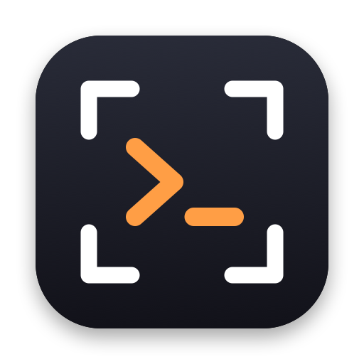
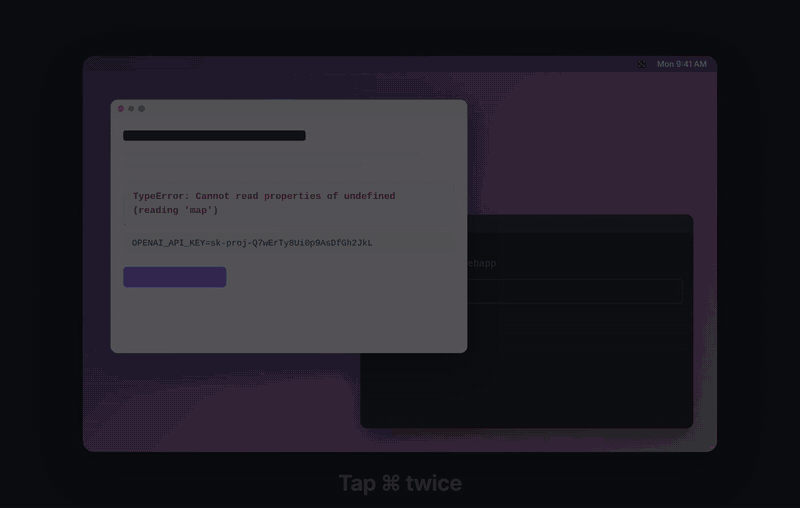

<p align="center"></p>

<h1 align="center">Yetda</h1>

<p align="center"><i>옜다 (yetda): Korean for “here, take it,” what you say as you hand something over.</i></p>

<p align="center">A tiny macOS menu bar app for getting screenshots into your terminal coding agent fast:<br>Claude Code, Codex, Gemini CLI, opencode, and more.</p>

<p align="center"></p>

- **One shot, right now** — tap ⌘ twice, select a region, and Yetda pastes
  it straight into the agent running in your terminal. No files to manage.
- **Several shots** — every capture is also saved to `~/Yetda/`; pick an
  earlier one with ⌘⇧1, or (Claude Code) feed them all at once with `/shots`.

## Works with

Yetda puts the image on the clipboard and presses your terminal's paste key,
so it works with any terminal agent that accepts a pasted image:

| Agent | Paste key on macOS | Status |
|---|---|---|
| Claude Code | `Ctrl+V` (`⌘V` in iTerm2) | tested |
| Codex CLI | `Ctrl+V` | should work |
| Gemini CLI | `Ctrl+V` | should work |
| opencode | `Ctrl+V` | should work |
| Cursor CLI | `⌘V` | set **Paste Key → ⌘V** in the menu |

Tried one of these? A PR to update this table is welcome.

The menu bar icon shows how many captures are waiting, and old ones are cleaned
up automatically — so the folder never fills up.

## Install

macOS 13 or later.

```bash
brew install --cask woonmayer/tap/yetda
```

Or download **[Yetda.dmg](https://github.com/woonmayer/homebrew-tap/releases/latest/download/Yetda.dmg)**,
open it and drag Yetda to Applications. Releases are signed with Developer ID
and notarized by Apple. (Maintainers: see [docs/releasing.md](docs/releasing.md).)

## Build from source

Needs a Swift toolchain (Xcode or Command Line Tools).

```bash
./scripts/build-app.sh        # produces Yetda.app (code-signed if an identity exists)
rm -rf /Applications/Yetda.app && mv Yetda.app /Applications/
open /Applications/Yetda.app
```

Move (don't copy) the bundle so only one `Yetda.app` exists — a second copy
can leave macOS showing a permission as granted while the running app still
gets the prompt. If that happens, reset with
`tccutil reset ScreenCapture io.github.woonmayer.yetda` (or `Accessibility`),
relaunch, and grant again.

`build-app.sh` signs with the first available code-signing identity (so macOS
permissions persist across rebuilds); it falls back to ad-hoc signing if none is
found. To pin a specific identity: `YETDA_SIGN_ID="Developer ID Application: …" ./scripts/build-app.sh`.

During development you can also run it straight from source: `swift run Yetda`.

**Upgrading from ClipShot** (the old name): delete `/Applications/ClipShot.app`,
install Yetda as above, and grant Screen Recording and Accessibility again —
macOS ties permissions to the bundle ID. Your settings and `~/ClipShot/`
captures move over automatically on first launch.

### First run: Screen Recording permission

macOS asks for **Screen Recording** permission the first time you capture
(required by `screencapture`). Grant it under
**System Settings → Privacy & Security → Screen Recording**, then relaunch the
app. If captures come out blank, the permission isn't granted yet.

## Usage

- **Capture:** press **⌘⇧2** from anywhere (macOS's own screenshots use ⌘⇧3/4/5,
  so ⌘⇧2 is free), or **tap ⌘ twice** (needs Accessibility, like auto-paste).
  Select a region — or press Space to capture a window. The image lands on
  your clipboard **and** in `~/Yetda/`.
- **Auto-paste:** right after the capture, Yetda brings your most recently
  used terminal to the front and presses the paste key for you (`Ctrl+V`; `⌘V` in iTerm2) — the image lands
  straight in your agent's prompt. Works with Terminal, iTerm2, Ghostty, Warp,
  WezTerm, kitty, Alacritty, Hyper, cmux, Orca and Kaku (add others from the
  menu, or see [Configuration](#configuration)). Needs **Accessibility** permission (macOS
  asks on first use; grant it under System Settings → Privacy & Security →
  Accessibility). Turn it off from the menu to get clipboard-only.
- **Paste manually:** with auto-paste off, press `Ctrl+V` in the terminal (`⌘V` in iTerm2).
- **Paste an earlier shot:** press **⌘⇧1** for a thumbnail menu of the 10
  newest captures; pick one (or press its number 1–9) and it's copied and
  auto-pasted just like a fresh capture.
- **Secrets are hidden:** before a capture reaches the clipboard, Yetda reads
  its text with on-device OCR and masks API keys, tokens, passwords,
  connection-string passwords and card numbers with a solid password-field
  pill (never blur, which can be reversed), in the saved PNG too. The menu
  bar shows 🔒 N when it hid something; if it hid too much, **Paste Last
  Capture Without Hiding** pastes the original (kept in memory only, for 5
  minutes). Known formats (OpenAI, Anthropic,
  GitHub, AWS, Slack, Google, Stripe, JWT, …) are matched by pattern; on Macs
  with Apple Intelligence, Apple's on-device model also judges random-looking
  strings that match no known format. This is a safety net, not a guarantee.
- **Paste the text, too (optional):** turn on *Also Paste Text from Capture*
  and, right after the image, Yetda pastes the text it read (with secrets
  replaced by `[REDACTED]`), so the agent gets exact error messages to search for.
- **Menu:** click the menu bar icon for:
  - **Capture** — same as the hotkey
  - **Open Folder** — reveal `~/Yetda/` in Finder
  - **Paste Recent** — same thumbnail list as ⌘⇧1
  - **Clear (N)** — empty the capture queue
  - **Auto-paste into Terminal** — toggle auto-paste (on by default)
  - **Also Paste into “<app>”** — shown when the app you were just in isn't a
    known terminal; tick it to make that app an auto-paste target
  - **Paste Key** — Automatic (`Ctrl+V`; `⌘V` in iTerm2), or force `Ctrl+V` /
    `⌘V` if your agent wants a different one
  - **Capture with ⌘⌘** — toggle the double-tap trigger (on by default; turn it
    off if another app, e.g. Codex, also uses ⌘⌘)
  - **Paste Last Capture Without Hiding** — shown after a capture had secrets masked
  - **Hide Secrets in Captures** — on by default
  - **Also Paste Text from Capture** — off by default (needs auto-paste)
  - **/shots Skill** — install or remove the skill per agent
  - **Support Yetda…** — opens the GitHub Sponsors page in your browser
  - **Quit**

The number next to the icon is how many captures are pending in `~/Yetda/`.
If a permission is missing, the menu shows a **⚠︎ Grant …** item at the top
that opens the right Settings pane.

## The `/shots` skill (Claude Code, Codex)

To feed several past captures into a session at once, use the companion
[Agent Skill](https://agentskills.io). Yetda ships it and, on first launch,
asks whether to install it for the agents it finds (Claude Code, Codex). It
only ever writes one file per agent and never touches other settings:

- Claude Code: `~/.claude/skills/shots/SKILL.md`
- Codex: `~/.agents/skills/shots/SKILL.md`

Turn it on or off per agent from the menu (**/shots Skill**). Yetda keeps its
own copies up to date when the app updates, and leaves a copy you've edited
alone. To install it by hand instead:

```bash
npx skills add woonmayer/yetda            # any agent, via vercel-labs/skills
# or
mkdir -p ~/.claude/skills/shots && cp skills/shots/SKILL.md ~/.claude/skills/shots/
```

Then in any session:

- `/shots` — feed **all** pending captures from `~/Yetda/`.
- `/shots N` — feed only the **N most recent**.

The chosen images are read into the session and then deleted from the folder
(the menu bar count drops accordingly). It's fast: only the images you feed are
read — there's no preview list to generate.

## Captures folder & cleanup

Captures are saved to `~/Yetda/` as `YYYY-MM-DD-HHMMSS-mmm.png` (UTC).
Yetda only ever lists or deletes files with that name pattern — anything
else you put in the folder is left alone. Captures leave the folder when:

- `/shots` feeds them into a session, or
- you click **Clear (N)**, or
- they pass the 7-day auto-prune (run on launch and after each capture).

Pasting with `Ctrl+V` does **not** remove a file — it's just a quick copy, so
the same shot stays available to `/shots` until one of the above removes it.

## Configuration

Toggles live in the menu. One setting has no UI — extra terminals to
auto-paste into, by bundle ID:

```bash
defaults write io.github.woonmayer.yetda extraTerminalBundleIDs -array com.example.MyTerminal
```

Find an app's bundle ID with `osascript -e 'id of app "MyTerminal"'`.

## Privacy

Yetda runs entirely on your Mac: no network access, no analytics. Captures
stay in `~/Yetda/` until you or `/shots` remove them. Text recognition
(Vision) and the secret check (pattern matching, plus Apple's on-device
Foundation Models where available) run locally too.

- **Screen Recording** lets the system `screencapture` tool capture the region
  you select.
- **Accessibility** is used for two things only: posting the paste keystroke into your
  terminal (auto-paste) and noticing a ⌘⌘ double tap. For the latter Yetda
  receives global key and click events, but it only checks *whether* something
  other than ⌘ was pressed — it never records or stores what you type. See
  `Sources/Yetda/Input/DoubleCommandMonitor.swift`. Turn both features off in the
  menu and the permission is no longer needed.

## How it works

- **`YetdaCore`**: pure, unit-tested logic. The `~/Yetda/` folder (naming,
  listing, 7-day prune, clear), the `screencapture -i` call, the ⌘⌘
  double-tap detector, which apps count as terminals and their paste keys,
  secret detection, mask geometry, and the pasted-text format.
- **`Yetda`**: the AppKit menu bar app, a thin layer over Core:

```
Sources/Yetda/
  App/       launch and wiring
  Menu/      menu bar item, badge, settings toggles, Paste Recent
  Capture/   capture → deliver pipeline, screencapture runner, folder watcher
  Paste/     auto-paste into the last terminal, synthetic paste keystroke, clipboard
  Scan/      on-device OCR, secret masking, Apple's on-device model check
  Input/     ⌘⇧2 / ⌘⇧1 hotkeys (Carbon, no permission), ⌘⌘ monitor
  System/    settings, permissions, migration from ClipShot
Sources/YetdaCore/      pure logic
Tests/YetdaCoreTests/   unit tests
skills/shots/           the /shots Claude Code skill
scripts/                build-app.sh (bundle + sign), release.sh (notarized dmg),
                        render-cask.sh, make-icon.sh
packaging/homebrew/     Homebrew cask template
promo/                  Remotion promo video
docs/                   landing page
```

The package builds in Swift 6 language mode, so data races are compile
errors; UI types are `@MainActor`, and blocking work (screencapture, OCR)
runs off the main actor.

## Contributing

Issues and pull requests are welcome. Before opening a PR, run
`swift build -Xswiftc -warnings-as-errors && swift test` (CI runs both), and
keep new logic in `YetdaCore` with a unit test where possible; the AppKit
layer should stay thin wiring.

## Support

Yetda is free. If it saves you time, you can [sponsor its development](https://github.com/sponsors/woonmayer) ♥

## License

[MIT](LICENSE)
